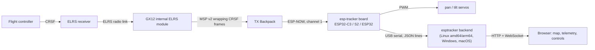

# esp-tracker

An antenna tracker and ground station for ExpressLRS drones, built around a cheap ESP32 board.

* **Telemetry without touching the radio's firmware.** The ExpressLRS *Backpack* of your TX module
  (the GX12's internal module has one) can forward every CRSF telemetry frame, GPS included, over
  ESP-NOW. An ESP32 listens to it.
* **Antenna tracker.** The ESP32 computes azimuth/elevation from the drone's GPS position and drives a
  pan/tilt servo pair carrying your VRX antennas.
* **Live ground station.** The ESP32 forwards everything as JSON lines over USB. A small Python
  application shows the drone on a map (online or offline tiles) with all the useful telemetry, and
  controls the tracker.



## Layout

| Path | What |
| --- | --- |
| [`firmware/`](firmware) | PlatformIO project for ESP32-C3, ESP32-S2 and classic ESP32. Portable logic in `lib/tracker_core` is unit tested on a PC. |
| [`backend/`](backend) | Python package `esptracker` (FastAPI + pyserial) with the web UI, a flight simulator and log replay. |
| [`docs/usage.md`](docs/usage.md) | **Start here**: wiring, flashing, radio/Backpack setup, running the app, calibration, troubleshooting. |
| [`docs/architecture.md`](docs/architecture.md) | How it is implemented: wire formats, UID/MAC derivation, tracking maths, serial protocol, backend design, tests. |

## Try it without any hardware

```sh
cd backend
python3 -m venv .venv && . .venv/bin/activate
pip install .
esptracker --simulate          # then open http://127.0.0.1:8080
```

## Tests

```sh
make -C firmware/tests test       # C++ core (CRC, MD5/UID, MSP, CRSF, geometry, tracker, commands), needs only g++
make -C firmware/tests syntax     # compile-check src/main.cpp against stub Arduino headers
cd backend && pip install -e '.[test]' && pytest
```

## Status

Written and tested on a PC. **Not yet run on real hardware**: the firmware has not been built with
PlatformIO or flashed here, so expect to adjust pins and servo limits (see the usage guide). The
ESP-NOW receive path copies what the ELRS Backpack firmware does, see
[`docs/architecture.md`](docs/architecture.md#esp-now-reception) for the exact sources.

Supported chips: ESP32-C3, ESP32-S2, ESP32. ESP8266 (Wemos D1 mini) is not covered yet. Bluetooth/Android
output is planned but not implemented (C3 and classic ESP32 have BLE, S2 does not).
